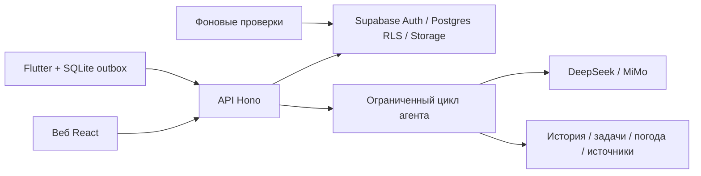

# Архитектура

Клиенты используют один контракт; Dart и TypeScript не обмениваются исходным кодом интерфейса. Точки API генерируются из общего описания. DTO описаны в `packages/contracts/src/index.ts`.

Рабочие данные привязаны к хозяйству. RLS и проверки API защищают доступ; поля запроса не определяют права. Модель получает только разрешённый контекст. Инструменты агента читают данные, а подтверждение рабочих изменений выполняется отдельным endpoint с ожидаемой версией записи.

Идентификатор операции стабилен при повторе. Подтверждение наблюдения и создание задачи — одна транзакция. При конфликте сохраняется локальная правка и возвращается текущая версия сервера.

Фоновые задания создают уведомления внутри приложения, с ключом дедупликации. Внешние сообщения не отправляются. Источники знаний имеют название, версию и ссылку; показ источника не является доказательством верности агрономического вывода.

## Облачный этап

После локальной приёмки: отдельный Supabase-проект и Cloudflare для веба; размещение Hono и фонового runner проверяется отдельно с учётом ограничений выбранного тарифа. Текущая Node-реализация не объявляется автоматически готовой к Workers. Перед публичным запуском нужны ограничения регистрации/демо, лимиты расходов, HTTPS и проверка политик хранения фото.
