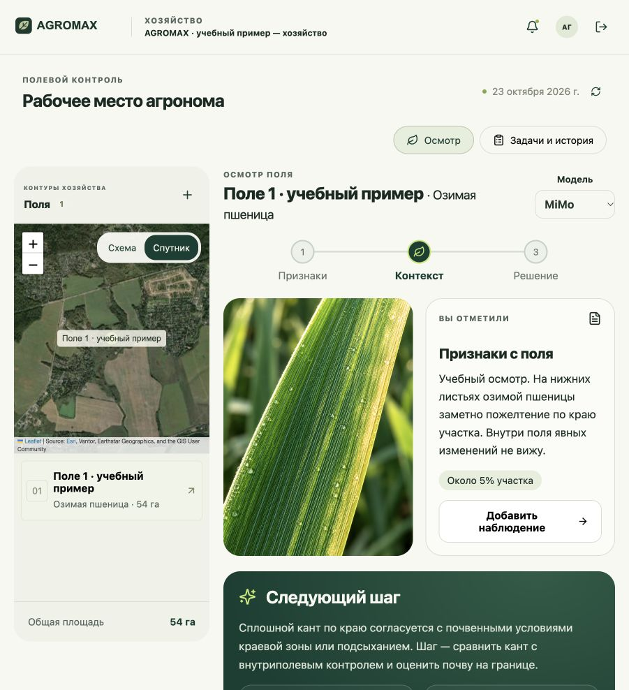
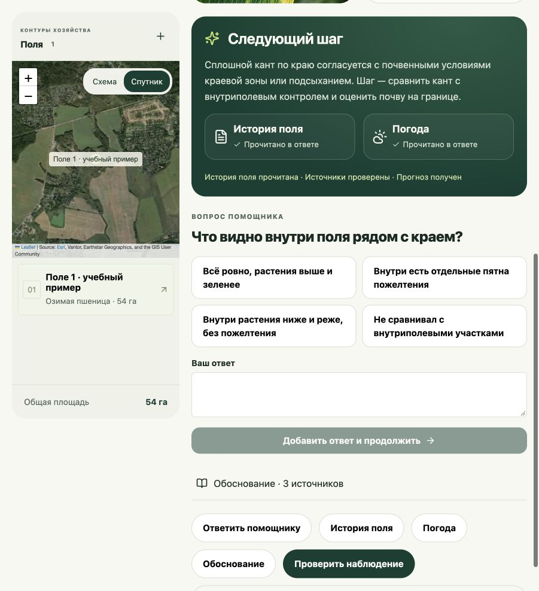
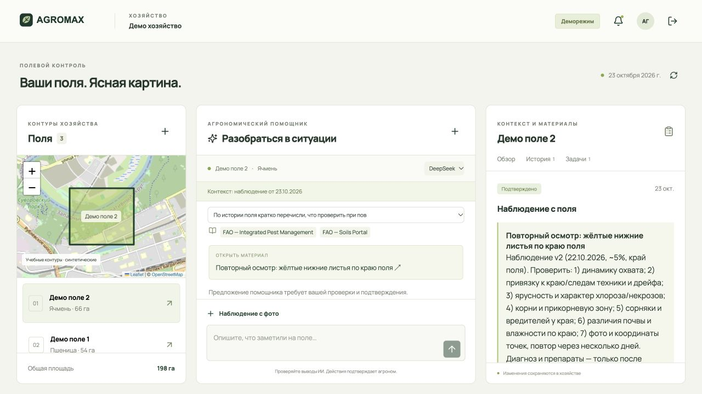
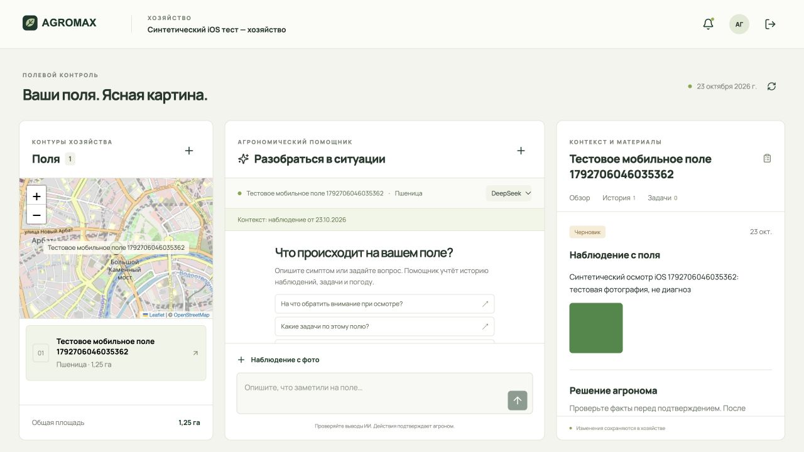

# Проверка локального MVP — 23 октября 2026

Проверки выполнены на локальном Supabase, с настоящими Auth/PostgreSQL/Storage. Все данные — синтетические. Старые домашки и облачные интеграции не изменялись.

| Область | Подтверждено |
|---|---|
| API и агент | 61 автоматический тест: маршруты, подтверждения, конфликты, ошибки/лимиты модели, загрузка и гонки фото |
| Веб | TypeScript, production build, 10 тестов повторных попыток, идентификаторов фото и контекста карточек |
| Flutter | Анализ без ошибок, 24 теста очереди/SQLite/повторных попыток и состояния карточек |
| Настоящая база | 11 сквозных проверок: вход, изолированное демо, фото, версии, подтверждение + задача, повторный осмотр, sync |
| Защита Supabase | 9 прямых проверок RPC/RLS: некорректные DTO, подделка агента, чужие данные, удаление фото, роли и scheduler |
| Нативный iOS | Реальный вход через UI, долговечная копия PNG, наблюдение через outbox, защищённое чтение фото с сервера, отсутствие дублей, повторное открытие SQLite |
| Перезапуск без API | Черновик сохранён после остановки и запуска процесса iOS; очередь также сохранилась, после восстановления API запись синхронизировалась |
| iOS → веб | Вход в один синтетический аккаунт: созданное на iOS наблюдение и фото видны в истории веба |
| Веб в Codex IAB | Проверены вход/демо, карта, погода, сохранение, отдельное подтверждение, создание задачи, ответ агента с источниками и артефактом |
| Фоновые задания | Сервисная функция запускается; повторный запуск не дублирует уведомления; обычному пользователю запуск запрещён |
| Секреты | `.env` и `.data` исключены из Git; действующие локальные ключи не обнаружены в публикуемых файлах |

## Обновлённое рабочее пространство

Выбранный дизайн объединён с настоящей спутниковой картой. Вопросы, варианты, доступные действия и источники приходят из проверенного ответа API. В вебе вручную пройден выбор варианта → новый ответ → отдельное подтверждение → задача → повторный осмотр. Нативный iOS-тест также нажимает реальный вариант DeepSeek, проверяет тот же диалог, сохранность локального черновика и отсутствие самовольного подтверждения/задач.

На iOS показаны Cupertino-навигация, вкладки и формы. Карточка содержит краткое резюме; полный ответ остаётся в обсуждении. Старая версия ответа сохраняется как история, без устаревших вопросов и предложений изменения данных.

## Провайдеры

Через интегрированный API проверены официальные endpoints:

- DeepSeek `deepseek-flash`: реальная карточка вопроса → ответ на выбранный вариант в том же диалоге; два запроса суммарно 16,5 секунды.
- MiMo `mimo-v2.6-flash`: тот же двухшаговый сценарий, суммарно 78,4 секунды; каждый отдельный запрос уложился в серверный лимит 60 секунд.

Время — наблюдения конкретных тестов, не SLA. Модель выбирается явно; ключи и выбор конкретной модели задаются только в серверном `.env`. История и проверенные источники читаются перед запросом; дополнительные инструменты вызываются в ограниченном цикле. Ошибки формата допускают один запрос исправления к самой модели, без обхода проверки источников/версий. Автоматической подмены провайдера нет.

## Воспроизведение

При работающих API и Supabase:

```sh
npm run check:integration
npm run check:workbench # реальный вопрос/ответ обоих провайдеров, платные API
npm run check:models # использует платные API; создаёт короткие синтетические запросы
npm run typecheck
npm test
npm run build
cd apps/mobile
flutter analyze
flutter test
flutter drive --driver=test_driver/native_backend_driver.dart --target=integration_test/native_backend_test.dart -d <simulator-id> --dart-define=API_BASE_URL=http://localhost:8787
```

Интеграционные команды создают отдельные синтетические аккаунты и хозяйства. Не запускайте их против рабочих данных. Детальные локальные результаты находятся в игнорируемой `.data`; очищенный протокол — `verification-results.json`.

## Пределы проверки

- Android-проект создан, но Android SDK на машине отсутствует: APK и запуск Android не подтверждены.
- iOS проверен на iPhone 17 Pro Simulator, iOS 26.4. Универсальная команда сборки симулятора сталкивается с несовместимостью проверки архитектур Flutter 3.38.7 / Xcode 27; сборка для конкретного устройства и запуск успешны.
- Физическая камера, реальные GPS-разрешения, подпись релиза и магазины приложений не проверялись.
- Передача фото проверена синтетическим PNG; облачная модель в первой версии получает текстовый контекст и не анализирует пиксели.
- Загрузка файлов и запись метаданных относятся к разным сервисам. Повтор безопасно возобновляет регистрацию; полностью заброшенные незавершённые загрузки потребуют будущей очистки.
- LiteRT, собственная CV-модель, облачный деплой и обновление старого DataLens новыми метриками в этот локальный релиз не входят.

## Новый дизайн и карточки





[Нативный iOS — осмотр](design/qa/ios-workbench-native.jpg) · [вопрос модели](design/qa/ios-question-native.jpg) · [протокол визуальной проверки](../design-qa.md)

## Доказательства предыдущего сквозного сценария





[Нативная история iOS](screenshots/ios-history.png)


## Облачное развёртывание — 23 октября 2026

Публичный origin: https://agromax-itmo.onrender.com. Прошли 10 облачных интеграционных сценариев, 9 проверок прав/валидации и по живому запросу DeepSeek/MiMo с инструментами. Нативный iOS-тест прошёл через тот же облачный сервер; созданное им наблюдение с фото видно в публичном вебе. Фактический cron-запуск успешен. Детали и ограничения: [DEPLOYMENT.md](DEPLOYMENT.md).
